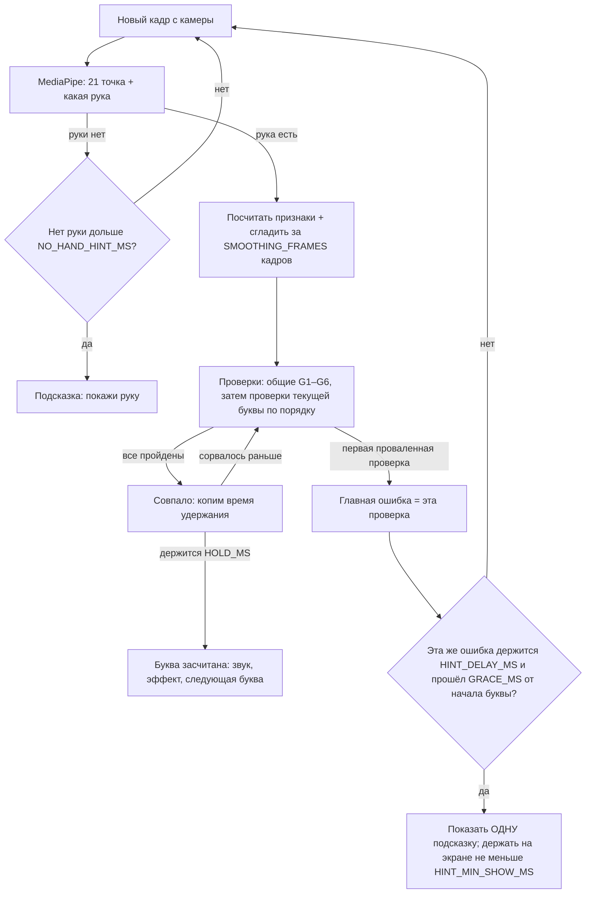

# GESTURES.md — буквы, признаки руки и режим «ошибка»

Проект: «Азбука жестов» — тренажёр русской дактильной азбуки (РЖЯ) через веб-камеру.
Кейс: ADMIT «Motion», `brief/case.txt` (обязательный твист «Режим ошибка» — стр. 2).

Этот документ — главный для файлов `js/hand-features.js`, `js/letters.js`, `js/mistakes.js`, `js/config.js`.
Всё, что здесь помечено **[калибровать]**, — стартовое значение, его нужно проверить на руках 2–3 человек (см. раздел 9).

---

## 1. Что такое дактильная азбука (коротко, для защиты)

- Русская дактильная азбука — вспомогательная система русского жестового языка: каждой букве соответствует положение пальцев одной руки (дактилема), всего 33 знака. Показывают правой рукой, согнутой в локте, **ладонью к собеседнику** [1][2].
- Методист И. Ф. Гейльман разделил буквы на 7 групп по форме руки; в группах I–IV кисть **поднята пальцами вверх**, в группе V — опущена пальцами вниз [3].
- 25 букв статичные, 8 — с движением: **Д, Ё, З, Й, Ц, Щ, Ъ, Ь** [4]. В другой работе к «движущимся» относят также Г, К, Л, П [5]. Мы берём только буквы, которые **все** источники считают статичными.
- Легко спутать: Л/П и М/Т (отличаются только расстоянием между пальцами), Е/Ё, И/Й, Ш/Щ (отличаются только движением) [4]. Этих пар у нас нет.

---

## 2. Выбранные буквы (10 штук)

Критерии выбора: 1) буква статичная; 2) форму можно описать через «какой палец прямой / согнут / касается большого» — это надёжно видно по 21 точке MediaPipe с фронтальной камеры; 3) кисть пальцами вверх, ладонью к камере (без поворотов вниз, как у Г/П/Л/М/Т); 4) из букв складываются слова.

Порядок = порядок обучения (от простого к сложному). Состояние пальцев: **П** — прямой, **С** — согнут (прижат к ладони), **~** — полусогнут (дуга), **К** — касается кончиком большого пальца.

| № | Буква | Форма руки (по источникам) | Б. палец | Указ. | Сред. | Безым. | Мизинец | Источник |
|---|---|---|---|---|---|---|---|---|
| 1 | **В** | Ладонь раскрыта, пальцы прямые и сомкнуты, большой палец прижат к ладони | прижат | П | П | П | П | [6][7] |
| 2 | **А** | Кулак, большой палец выпрямлен и прижат сбоку к указательному | вдоль сбоку | С | С | С | С | [6][7] |
| 3 | **У** | Кулак, мизинец выпрямлен, большой палец отведён в сторону | отведён | С | С | С | П | [7] |
| 4 | **И** | Кулак, выпрямлены безымянный и мизинец | держит согнутые | С | С | П | П | [7] |
| 5 | **Ы** | Кулак, выпрямлены указательный и мизинец | держит согнутые | П | С | С | П | [7] |
| 6 | **Ш** | Ладонь выпрямлена, мизинец и большой палец образуют кольцо (три пальца вверх — как буква «Ш») | К мизинца | П | П | П | К | [6][7][3] |
| 7 | **О** | Ладонь выпрямлена, указательный и большой образуют колечко, остальные прямые | К указат. | К | П | П | П | [6][7][8] |
| 8 | **Н** | Указательный, средний и мизинец вверх, безымянный и большой образуют колечко | К безым. | П | П | К | П | [6][7][8] |
| 9 | **Р** | Средний и большой образуют колечко, остальные выпрямлены вверх | К средн. | П | К | П | П | [6][7][8] |
| 10 | **С** | Пальцы образуют полукольцо (как буква «С»), большой палец напротив, **не касается** | напротив, просвет | ~ | ~ | ~ | ~ | [6][7] |

Группы Гейльмана подтверждают логику: группа I «А, Е, Ё, С, В» — пальцы постепенно раскрываются; группа II «О, Р, Н, Ш, Щ» — большой палец **поочерёдно соединяется** с указательным, средним, безымянным, мизинцем; группа III «К, Ы, И, Й, У» — прямые пальцы раскрыты при поднятой кисти [3].

### 2.1. Спорные места и расхождения источников

1. **О.** Все найденные текстовые описания (два независимых пересказа и группировка Гейльмана) дают «колечко из указательного и большого, остальные прямые» [6][7][8][3]. По памяти составителя документа, на некоторых рисованных таблицах О выглядит как «округлённая кисть» (все пальцы в кольцо) — источником это **не подтверждено**. Решение: делаем по текстовым источникам; перед записью эталонного фото сверить с видео (раздел «Обучающее видео» / мультфильм «Дактиль» на signlang.ru [2]).
2. **Р.** Один автоматический пересказ поисковика дал «средний и указательный образуют кольцо» — это похоже на искажение; основные источники и логика группы II — «средний + большой» [6][8][3]. Делаем «средний + большой».
3. **В — положение большого пальца.** Текст источников: «ладонь раскрыта, пальцы вместе» [6][7] — про большой палец не сказано. На таблицах он прижат к ладони. Проверяем только «большой палец не отведён в сторону» — это мягче и не даст ложных ошибок.
4. **С — ориентация.** В источниках только «пальцы образуют полукольцо» [6][7]. Полукольцо лучше видно, если кисть чуть повернуть ребром. Для С **не проверяем** ориентацию ладони (только «пальцы вверх, не кулак, не касаются»).
5. **Ш** в источниках: «мизинец и большой образуют кольцо» — на практике большой палец часто лежит на ногте согнутого мизинца, а не «кончик в кончик». Поэтому «касание» считаем по ближайшей из двух точек пальца: кончик или верхний сустав (см. 4.4). То же для О, Н, Р.
6. **Динамические буквы.** Список «8 динамических» [4] не включает Г, К, Л, П, а работа [5] включает. Нам неважно — ни одна из них не выбрана.

### 2.2. Пары, которые легко спутать, и чем они различаются

| Пара | Чем различаются | Какую подсказку даём |
|---|---|---|
| И ↔ Ы | Какой палец рядом с мизинцем прямой: у И — безымянный, у Ы — указательный | «Сейчас похоже на «И». Для «Ы» выпрями указательный и согни безымянный» |
| А ↔ У | У «У» большой палец отведён и мизинец прямой; у «А» всё прижато | «Отведи большой палец в сторону» / «Прижми большой палец сбоку к указательному» |
| В ↔ Ш | У «Ш» мизинец согнут и касается большого | «Согни мизинец и прижми его большим пальцем» |
| Ш ↔ Н ↔ Р ↔ О | Какой палец касается большого (мизинец / безымянный / средний / указательный) | «Большой палец касается среднего, а нужно — безымянного» |
| О ↔ С | У «О» кольцо замкнуто и три пальца прямые; у «С» просвет и все пальцы дугой | «Оставь просвет между большим и указательным» / «Соедини кончики — получится колечко» |
| С ↔ А | У «С» пальцы дугой, у «А» — в кулак | «Не сжимай кулак — согни пальцы полукругом, как будто держишь стакан» |
| С ↔ В | У «С» пальцы дугой, у «В» — прямые | «Слегка согни пальцы полукругом» |
| А ↔ «кулак с большим поперёк» | У «А» большой палец прямой и лежит сбоку, а не поверх пальцев | «Не клади большой палец на пальцы — выпрями его и прижми сбоку к указательному» |

---

## 3. Слова для экзамена «собери слово»

Правила: только буквы из раздела 2, без двух одинаковых букв подряд (иначе непонятно, когда засчитывать вторую), 2–4 буквы. Экзамен берёт только слова, все буквы которых уже пройдены в уроках.

| Доступно после | Слова |
|---|---|
| Урок 2 (В, А, У, И, Ы, Ш) | УШИ, ВАШ, ВЫ |
| Урок 3 (+ О, Н, Р, С) | СЫР, НОС, СОН, ШАР, РИС, ОСА, УСЫ, ВАС, НАШ, ШОВ, СОВА, НОРА, ШИНА, РОСА |

Запасной вариант, если Н и Р окажутся ненадёжными при калибровке (их выкидываем): ОСА, УСЫ, ВАШ, УШИ, СОВА, ВАС, ШОВ, ВЫ.

Уроки:
- Урок 1: В, А, У (самые непохожие — хорошие первые буквы).
- Урок 2: И, Ы, Ш.
- Урок 3: О, Н, Р, С.

---

## 4. Точки MediaPipe и признаки руки (`js/hand-features.js`)

### 4.1. Номера точек Hand Landmarker (21 точка)

```
0  запястье (WRIST)
1–4   большой палец:   1 основание, 2 MCP, 3 IP (сустав), 4 кончик
5–8   указательный:    5 MCP (костяшка), 6 PIP (средний сустав), 7 DIP (верхний сустав), 8 кончик
9–12  средний:         9 MCP, 10 PIP, 11 DIP, 12 кончик
13–16 безымянный:      13 MCP, 14 PIP, 15 DIP, 16 кончик
17–20 мизинец:         17 MCP, 18 PIP, 19 DIP, 20 кончик
```

Таблица для кода (одно место, `config.js`):

| Палец | MCP | PIP | DIP | Кончик |
|---|---|---|---|---|
| указательный | 5 | 6 | 7 | 8 |
| средний | 9 | 10 | 11 | 12 |
| безымянный | 13 | 14 | 15 | 16 |
| мизинец | 17 | 18 | 19 | 20 |
| большой | 2 (MCP) | 3 (IP) | — | 4 |

### 4.2. Какие координаты брать

MediaPipe отдаёт два набора точек:
- `landmarks` — координаты **в кадре** (x, y от 0 до 1). Их используем для: рисования скелета, проверки «рука далеко / близко / у края», ориентации ладони, курсора-пальца в меню.
- `worldLandmarks` — **3D-координаты в метрах** относительно центра руки. Их используем для углов и расстояний между пальцами: они почти не зависят от того, как далеко рука от камеры, и учитывают глубину (важно для согнутых пальцев, которые с фронтальной камеры «смотрят» на нас).

Внимание: в разных версиях библиотеки поле с рукой называется `handedness` или `handednesses` — проверить в консоли на шаге 2 плана.

### 4.3. Базовые формулы

- **Расстояние** `dist(A, B)` = √((xA−xB)² + (yA−yB)² + (zA−zB)²).
- **Размер ладони** `palm = dist(0, 9)` (запястье → костяшка среднего). Все расстояния делим на `palm` — тогда пороги одинаковы для большой и маленькой руки.
- **Угол в суставе** `angle(A, B, C)` — угол в точке B между направлениями B→A и B→C, в градусах: `arccos( (BA · BC) / (|BA| · |BC|) )`. Прямой палец ≈ 180°, сильно согнутый ≈ 40–70°.

### 4.4. Признаки, которые считаем каждый кадр

| Признак | Формула | Значения |
|---|---|---|
| Сгиб пальца (указ., средн., безым., мизинец) | `bend = angle(MCP, PIP, кончик)` | `STRAIGHT` если `bend ≥ FINGER_STRAIGHT_MIN_ANGLE`; `BENT` если `bend ≤ FINGER_BENT_MAX_ANGLE`; иначе `HALF` (полусогнут) |
| Большой палец выпрямлен | `angle(2, 3, 4) ≥ THUMB_STRAIGHT_MIN_ANGLE` | да / нет |
| Большой палец отведён | `dist(4, 5) / palm ≥ THUMB_OUT_MIN_DIST` | да / нет |
| Большой палец вдоль указательного (буква А) | `dist(4, 6) / palm ≤ THUMB_SIDE_MAX_DIST` и большой выпрямлен | да / нет |
| Касание большим пальцем пальца X | `touch(X) = min(dist(4, кончик X), dist(4, DIP X)) / palm` | касается, если `≤ TOUCH_MAX_DIST` |
| Какой палец касается большого | палец с минимальным `touch(X)`, если он `≤ TOUCH_MAX_DIST`; иначе «никакой» | указ. / средн. / безым. / мизинец / нет |
| Просвет у «С» | `dist(4, 8) / palm ≥ GAP_MIN_DIST` | есть / нет |
| Пальцы сомкнуты (буква В) | `dist(8,12)`, `dist(12,16)`, `dist(16,20)` делённые на `palm` — все `≤ FINGERS_TOGETHER_MAX_DIST` | да / нет |
| Размер руки в кадре | `palmOnScreen` = расстояние 0→9 в **пикселях** / высота кадра | для «далеко / близко» |
| Рука у края | любая из 21 точки ближе `EDGE_MARGIN` к краю кадра | да / нет |
| Пальцы вверх | угол между вектором 0→9 (в кадре) и вертикалью вверх | `≤ FINGERS_UP_MAX_TILT` — ок |
| Ориентация ладони | см. 4.5 | к камере / тыльной стороной / ребром |

### 4.5. Ориентация ладони и левая/правая рука (зеркало)

Считаем по трём точкам ладони в **кадре** (в пикселях, чтобы ширина и высота были в одних единицах):

```
cross = (x5 − x0)·(y17 − y0) − (y5 − y0)·(x17 − x0)
palmFacing = cross / (palmOnScreenPx)²        — число без единиц
```

- Для **правой** руки ладонью к камере в **незеркальном** кадре `cross < 0`, для левой — `cross > 0` (проверено рассуждением: большой палец правой руки при этом виден справа от мизинца).
- Поэтому: `palmSign = isRightHand ? −palmFacing : palmFacing`.
  - `palmSign ≥ PALM_FACING_MIN` — ладонь к камере (ок);
  - `palmSign ≤ −PALM_FACING_MIN` — к камере тыльная сторона;
  - между ними — рука стоит ребром.
- **Какая рука.** Проверено на тестовых фото MediaPipe (`pointing_up.jpg`, `victory.jpg` — ладонь к камере): для обычного незеркального кадра метка MediaPipe совпадает с тем, как рука выглядит в кадре. Поэтому `HANDEDNESS_SWAPPED = false` и `isRightHand = (метка === "Right")`. Проверка на живой камере: `?debug=1`, правая рука ладонью к камере → должно быть «ориентация: palm».
- **Зеркало на экране.** Видео и скелет рисуем отражёнными (CSS `transform: scaleX(-1)`), чтобы пользователю было привычно, как в зеркале. Координаты для расчётов при этом **не отражаем**.
- Все остальные признаки (углы, расстояния) одинаковы для левой и правой руки, поэтому левша может показывать левой рукой — сработает всё.
- В подсказках **не используем слова «влево/вправо»** (из-за зеркала путаница) — только «к камере», «вверх», «к большому пальцу», «ближе/дальше».

### 4.6. Сглаживание

MediaPipe «дрожит». Для каждого числового признака храним последние `SMOOTHING_FRAMES` значений и берём среднее. Состояния (прямой/согнут и т.д.) считаем уже по сглаженным числам.

---

## 5. Эталоны букв (`js/letters.js`)

Каждая буква — это список **проверок в порядке важности**. Проверка = одно условие + текст подсказки, если условие не выполнено. Первая проваленная проверка — это и есть «главная ошибка» (см. раздел 6).

Общие проверки для всех букв (идут первыми, в `mistakes.js`, не в каждой букве):

| № | Условие | Подсказка |
|---|---|---|
| G1 | Рука видна | «Не вижу руку — покажи ладонь в камеру» (через `NO_HAND_HINT_MS`) |
| G2 | Рука не у края | «Рука выходит за край кадра — сдвинь её к центру» |
| G3 | `palmOnScreen ≥ HAND_TOO_SMALL` | «Рука слишком далеко — поднеси её ближе к камере» |
| G4 | `palmOnScreen ≤ HAND_TOO_BIG` | «Рука слишком близко — отодвинь её немного» |
| G5 | Пальцы вверх | «Держи кисть прямо — пальцами вверх» |
| G6 | Ладонь к камере (кроме С) | тыльная: «Камера видит тыльную сторону — разверни ладонь к камере»; ребро: «Поверни ладонь к камере» |

Проверки по буквам (после общих). Название пальца подставляется из словаря: вин. падеж — «указательный палец», «средний палец», «безымянный палец», «мизинец», «большой палец»; род. падеж — «указательного», «среднего», «безымянного», «мизинца».

**В** — ладонь, пальцы вместе
1. Указ., средн., безым., мизинец = STRAIGHT → «Выпрями {палец}» (если согнуто несколько — «Выпрями все пальцы»).
2. Большой НЕ отведён → «Прижми большой палец к ладони».
3. Пальцы сомкнуты → «Сомкни пальцы — между ними не должно быть щелей».

**А** — кулак, большой вдоль
1. Указ., средн., безым., мизинец = BENT → «Согни {палец} и прижми к ладони» (все прямые — «Сожми пальцы в кулак»).
2. Большой выпрямлен → «Не клади большой палец на пальцы — выпрями его».
3. Большой вдоль указательного (не отведён) → если отведён: «Прижми большой палец сбоку к указательному»; если далеко от 6, но не отведён — то же.

**У** — кулак, мизинец и большой в стороны
1. Мизинец = STRAIGHT → «Выпрями мизинец».
2. Указ., средн., безым. = BENT → «Согни {палец} к ладони».
3. Большой отведён → «Отведи большой палец в сторону».

**И** — безымянный и мизинец вверх
1. Безымянный = STRAIGHT → «Выпрями безымянный палец».
2. Мизинец = STRAIGHT → «Выпрями мизинец».
3. Указательный = BENT → «Согни указательный палец».
4. Средний = BENT → «Согни средний палец».
5. Большой НЕ отведён → «Прижми большой палец к согнутым пальцам».

**Ы** — указательный и мизинец вверх
1. Указательный = STRAIGHT → «Выпрями указательный палец».
2. Мизинец = STRAIGHT → «Выпрями мизинец».
3. Средний = BENT → «Согни средний палец».
4. Безымянный = BENT → «Согни безымянный палец».
5. Большой НЕ отведён → «Прижми большой палец к согнутым пальцам».

**Ш** — три пальца вверх, мизинец держит большой
1. Указ., средн., безым. = STRAIGHT → «Выпрями {палец}».
2. Касание большого = мизинец → если касается другой палец: «Большой палец касается {другого}, а нужно — мизинца»; если никакого: «Согни мизинец и прижми его большим пальцем».

**О** — колечко из указательного и большого
1. Касание большого = указательный → другой палец: «Большой палец касается {другого}, а нужно — указательного»; никакого: «Соедини кончики большого и указательного — получится колечко».
2. Средн., безым., мизинец = STRAIGHT → «Выпрями {палец}».

**Н** — колечко из безымянного и большого
1. Касание большого = безымянный → другой: «Большой палец касается {другого}, а нужно — безымянного»; никакого: «Соедини кончики большого и безымянного пальцев».
2. Указ., средн., мизинец = STRAIGHT → «Выпрями {палец}».

**Р** — колечко из среднего и большого
1. Касание большого = средний → другой: «Большой палец касается {другого}, а нужно — среднего»; никакого: «Соедини кончики большого и среднего пальцев».
2. Указ., безым., мизинец = STRAIGHT → «Выпрями {палец}».

**С** — полукольцо (ориентацию ладони не проверяем)
1. Ни один из четырёх пальцев не BENT → «Не сжимай кулак — раскрой пальцы полукругом».
2. Ни один из четырёх пальцев не STRAIGHT → «Слегка согни пальцы полукругом, как будто держишь стакан».
3. Есть просвет между 4 и 8 → «Оставь просвет между большим и указательным — иначе получится «О»».

Для каждой буквы в `letters.js` также: короткое описание для урока (из таблицы раздела 2), путь к эталонному фото (`assets/letters/<буква>.jpg`), номер урока.

---

## 6. Общий алгоритм распознавания и выбора подсказки



Пошагово:
1. **Кадр → точки.** Раз в кадр (`requestAnimationFrame`) отдаём видео в Hand Landmarker (`runningMode: "VIDEO"`, `numHands: 1`). Получаем 21 точку в кадре, 21 точку в метрах, метку руки.
2. **Точки → признаки.** Считаем признаки из раздела 4.4, сглаживаем (4.6).
3. **Признаки → проверки.** Идём по списку: общие G1–G6, потом проверки буквы. Останавливаемся на **первой** проваленной — это главная ошибка. Так пользователь всегда видит одну, самую важную подсказку, а не пять сразу.
4. **Совпадение.** Если все проверки пройдены — запускаем таймер удержания. Буква засчитана, если совпадение держится непрерывно `HOLD_MS`. Прогресс удержания показываем кольцом вокруг буквы.
5. **Подсказка без мигания.**
   - Первые `GRACE_MS` после появления новой буквы подсказки не показываем — человек ещё перестраивает руку.
   - Подсказку показываем, только если **одна и та же** главная ошибка держится `HINT_DELAY_MS`.
   - Показанная подсказка висит минимум `HINT_MIN_SHOW_MS`, даже если ошибка сменилась (иначе текст дёргается). Исчезает сразу, если буква засчитана.
6. **«Похоже на другую букву».** Дополнительно проверяем, не совпадает ли рука полностью с **другой** буквой из списка. Если да — перед подсказкой пишем «Сейчас похоже на «И». » (например: «Сейчас похоже на «И». Выпрями указательный палец»). Это хорошо показывает жюри, что система именно понимает форму руки.
7. **Подсветка на скелете.** Пальцы, которые не прошли проверку, рисуем красным, правильные — зелёным. Палец из главной ошибки дополнительно подсвечиваем толстой линией.
8. **Учёт ошибок для итогов.** Буква считается «с ошибкой», если по ней показали `MISTAKE_HINTS_COUNT` = 2 и больше подсказок по форме руки или букву пропустили (одна подсказка — это нормальное обучение: первое же живое тестирование дало 0% точности при правиле «хотя бы одна») (проверки буквы и G5–G6; проверки G1–G4 про камеру ошибкой не считаем).

### Тон подсказок

Дружелюбно, на «ты», глагол в начале, одно действие: «Согни указательный палец». Если провалена только одна проверка буквы — добавляем «Почти! » в начало. После засчитанной буквы — короткая похвала из списка («Отлично!», «Точно!», «Супер!»).

---

## 7. Константы (`js/config.js`) — стартовые значения [калибровать]

| Константа | Значение | Что означает и почему |
|---|---|---|
| `FINGER_STRAIGHT_MIN_ANGLE` | ~~150°~~ **135°** (калибровка 28.09) | Угол в среднем суставе, начиная с которого палец считаем прямым. Совсем прямой ≈ 170–180°, оставляем запас на дрожание |
| `FINGER_BENT_MAX_ANGLE` | 100° | Ниже — палец согнут (в кулаке ≈ 40–70°). Между 100° и 150° — «полусогнут» (нужно для «С») |
| `THUMB_STRAIGHT_MIN_ANGLE` | 150° | Большой палец выпрямлен (для «А») |
| `THUMB_OUT_MIN_DIST` | ~~0.8~~ **0.6** (калибровка 28.09) | Кончик большого дальше 0.8 ладони от костяшки указательного — палец отведён (для «У») |
| `THUMB_SIDE_MAX_DIST` | 0.6 | Кончик большого ближе 0.6 ладони к среднему суставу указательного — лежит вдоль (для «А») |
| `TOUCH_MAX_DIST` | 0.3 | Кончик большого ближе 0.3 ладони к пальцу — считаем касанием (для О, Н, Р, Ш) |
| `GAP_MIN_DIST` | 0.45 | Просвет у «С»: больше, чем касание, с запасом, чтобы О и С не путались |
| `FINGERS_TOGETHER_MAX_DIST` | 0.35 | Кончики соседних пальцев ближе 0.35 ладони — пальцы сомкнуты (для «В») |
| `PALM_FACING_MIN` | 0.25 | Насколько «развёрнута» ладонь к камере; меньше — рука стоит ребром |
| `FINGERS_UP_MAX_TILT` | 40° | Кисть можно наклонить не больше чем на 40° от вертикали |
| `HAND_TOO_SMALL` | 0.10 | Ладонь меньше 10% высоты кадра — рука далеко, точки неточные |
| `HAND_TOO_BIG` | 0.40 | Ладонь больше 40% высоты кадра — рука близко, пальцы вылезут из кадра |
| `EDGE_MARGIN` | 0.03 | Точка ближе 3% к краю кадра — рука обрезана |
| `SMOOTHING_FRAMES` | 5 | Среднее по 5 кадрам убирает дрожание, но задержка всего ≈ 0,15 с |
| `HOLD_MS` | 700 | Сколько держать правильную букву, чтобы засчитать (случайное совпадение при перестроении руки не засчитается) |
| `GRACE_MS` | 1500 | После новой буквы 1,5 с не ругаемся — человек перестраивает руку |
| `HINT_DELAY_MS` | 800 | Одна и та же ошибка должна держаться 0,8 с, прежде чем показать подсказку |
| `HINT_MIN_SHOW_MS` | 1500 | Подсказка висит минимум 1,5 с — чтобы успеть прочитать и не мигала |
| `NO_HAND_HINT_MS` | 1000 | Через 1 с без руки пишем «покажи руку» |
| `HANDEDNESS_SWAPPED` | false | Метка MediaPipe не перевёрнута — проверено на тестовых фото (раздел 4.5) |

---

## 8. Как пороги объяснять жюри

«Мы не используем готовый классификатор жестов MediaPipe. MediaPipe даёт нам только 21 точку руки. Дальше — наша логика: считаем угол в каждом суставе и расстояния между кончиками пальцев, делим на размер ладони, сравниваем с эталоном буквы по списку проверок и по первой проваленной проверке говорим, какой палец поправить».

---

## 9. Калибровка (обязательный шаг плана)

1. Включить отладочную панель (`?debug=1` в адресе): на экране числа — угол каждого пальца, `touch` для каждого пальца, `palmFacing`, `palmOnScreen`.
2. Каждый из 2–3 человек показывает каждую букву правильно и с типичной ошибкой. Записать числа в таблицу (можно в конец этого файла).
3. Порог ставить посередине между «правильно» и «ошибка». Если диапазоны перекрываются — букву убрать (сначала Н и Р, запасные слова в разделе 3).
4. Проверить при обычном комнатном свете и на телефоне.

---

## 10. Источники

1. Русская дактильная азбука — Википедия: https://ru.wikipedia.org/wiki/Русская_дактильная_азбука
2. Дактильный алфавит — Лаборатория лингвистики жестового языка: https://signlang.ru/studyrsl/daktil/
3. Метод Гейльмана — signlang.ru: https://signlang.ru/studyrsl/daktil/method/
4. Bukva: Russian Sign Language Alphabet (SberDevices, arXiv 2410.08675): https://arxiv.org/html/2410.08675v1 и статья на Хабре: https://habr.com/ru/companies/sberdevices/articles/850858/
5. Формализация классов дактилем РЖЯ для робо-руки (Современные наукоёмкие технологии): https://top-technologies.ru/article/view?id=38820
6. «Дактиль — алфавит глухих: описание» (Опиши мне): https://xn----jtbhavgci6f.xn--p1ai/post-2644
7. «Учим дактильную азбуку» (Инфоурок, журнал для родителей): https://infourok.ru/zhurnal-dlya-roditelej-uchim-daktilnuyu-azbuku-4230739.html
8. «Русская дактильная азбука» (И. Поволоцкая, Проза.ру): https://proza.ru/2014/08/25/1590

---

## 11. Результаты калибровки

| Дата | Кто, устройство | Что увидели на ?debug=1 | Что поменяли |
|---|---|---|---|
| 28.09 | Живая рука, камера телефона (iPhone, Safari) | Раскрытая ладонь: углы пальцев 147°, 149°, 156°, 148° — три пальца попали в «полусогнут» при пороге 150°. Большой палец отведён — 0.54 при пороге 0.8. Буквы У и Ы почти не засчитывались | `FINGER_STRAIGHT_MIN_ANGLE` 150° → 135°, `THUMB_OUT_MIN_DIST` 0.8 → 0.6 |
