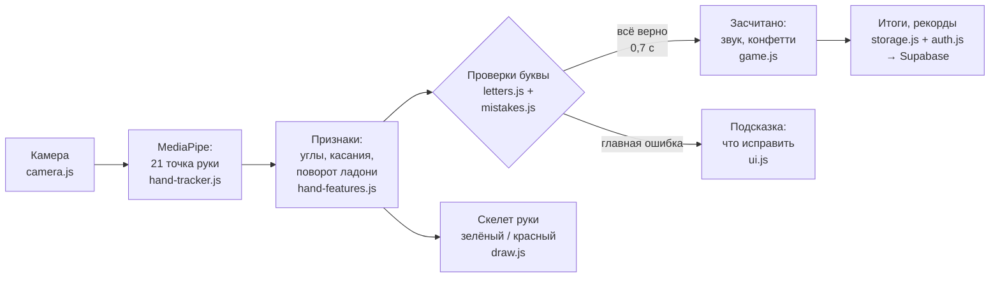
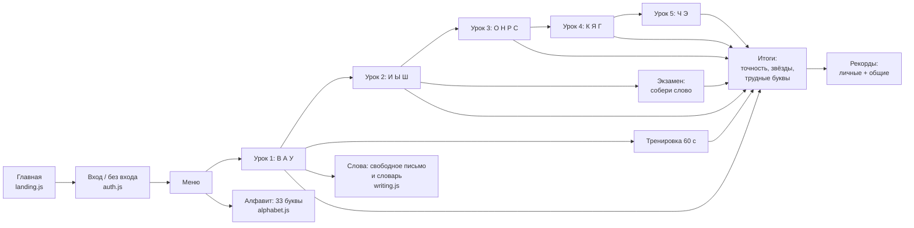

# Как устроена «Азбука жестов»

Этот документ — карта проекта для команды: что происходит от момента, когда человек поднял руку, до итогов и рекордов. Для каждого шага — файл и функция, чтобы любой из нас мог открыть код и объяснить его жюри.

Подробно про буквы, формулы и пороги — [GESTURES.md](GESTURES.md). План работ — [PLAN.md](PLAN.md).

---

## 1. Общая схема

Всё считается **в браузере**. Видео никуда не отправляется. В интернет уходят только результаты (звёзды, рекорды) — и только если человек вошёл в аккаунт.

---

## 2. Путь одного кадра (≈30–60 раз в секунду)

Главный цикл — функция `loop()` в [js/main.js](../js/main.js). Её вызывает `requestAnimationFrame` перед каждой перерисовкой экрана.

| Шаг | Что происходит | Файл → функция |
|---|---|---|
| 1 | Берём текущий кадр видео с веб-камеры | `camera.js → startCamera()` (один раз при запуске) |
| 2 | MediaPipe находит руку и возвращает **21 точку**: координаты в кадре и в метрах (3D) | `hand-tracker.js → detectHand()` |
| 3 | Из точек считаем **признаки**: угол в суставе каждого пальца → прямой / полусогнут / согнут; какой палец касается большого; отведён ли большой; сомкнуты ли пальцы; поворот ладони; размер руки в кадре; у края ли рука | `hand-features.js → computeFeatures()` |
| 4 | Сглаживаем числа по 5 кадрам, чтобы не «дрожали» | `hand-features.js → smooth()` |
| 5 | Проверяем жест «указка» (прямой только указательный) — это курсор для кнопок | `hand-features.js → isPointingGesture()` |
| 6 | «Судья» текущей буквы решает: засчитать, копить удержание или подсказать | `mistakes.js → LetterJudge.update()` |
| 7 | Игра реагирует: похвала, конфетти, следующая буква, таймер, итоги | `game.js → onFrame()` |
| 8 | Рисуем скелет руки: верные пальцы зелёные, ошибочные красные, главный — толще | `draw.js → drawHand()` |
| 9 | Двигаем курсор-палец, «нажимаем» кнопку, если держим на ней палец 1,5 с | `ui.js → updateCursor()` |

---

## 3. Как распознаётся буква (наша логика)

MediaPipe даёт **только точки**. Что это за буква — решаем мы.

1. **Угол сгиба пальца** — угол в среднем суставе между «костяшка → сустав» и «сустав → кончик». Прямой палец ≈ 180°, согнутый ≈ 40–70°. Пороги: `FINGER_STRAIGHT_MIN_ANGLE = 150°`, `FINGER_BENT_MAX_ANGLE = 100°` ([config.js](../js/config.js)).
2. **Расстояния делим на размер ладони** (запястье → костяшка среднего). Поэтому одни и те же пороги работают для большой и маленькой руки, близко и далеко от камеры.
3. **Касание большого пальца**: расстояние от кончика большого до кончика *или* верхнего сустава другого пальца меньше `TOUCH_MAX_DIST = 0.3` ладони. Так отличаем О / Р / Н / Ш — у них колечко с разными пальцами.
4. **Направление пальцев** — вверх / вниз / вбок по углу «запястье → средний палец» (буква Г — единственная пальцами вниз; «указка» — только пальцем вверх, поэтому они не путаются). **Раствор и скрещивание** указательного и среднего отличают К от Я.
5. **Поворот ладони** — знак векторного произведения «запястье → указательный» × «запястье → мизинец». С учётом того, левая это рука или правая, понимаем: ладонь к камере, тыльная сторона или ребро.
6. **Эталон буквы** — это список проверок по важности ([letters.js](../js/letters.js)). Например, буква **Н**:
   1. большой палец касается безымянного;
   2. указательный прямой;
   3. средний прямой;
   4. мизинец прямой.

   Все проверки прошли и держатся `HOLD_MS = 700 мс` — буква засчитана.

---

## 4. Режим «ошибка» — как выбирается подсказка

Файл [js/mistakes.js](../js/mistakes.js), класс `LetterJudge`.

1. **Общие проверки** (для всех букв): видна ли рука → не у края кадра → не слишком далеко → не слишком близко → пальцы вверх → ладонь к камере.
2. Потом **проверки буквы** по порядку.
3. **Первая проваленная проверка = главная ошибка.** Показываем одну подсказку, а не пять сразу.
4. Текст подсказки конкретный, у каждой проверки свой: «Выпрями безымянный палец», «Большой палец касается среднего, а нужно — безымянного».
5. Если рука полностью совпала с **другой** буквой — добавляем «Сейчас похоже на «И».» (`findLookalike()`).
6. Если не прошла только одна проверка — добавляем «Почти!».
7. **Чтобы текст не мигал:**
   - первые `GRACE_MS = 1,5 с` после новой буквы не ругаемся — человек складывает пальцы;
   - ошибка должна держаться `HINT_DELAY_MS = 0,8 с`;
   - показанная подсказка висит минимум `HINT_MIN_SHOW_MS = 1,5 с`.
8. На скелете палец из ошибки красный и толще (`badFingers`, `mainFinger` → `draw.js`).
9. **Для итогов:** одна подсказка — это нормальное обучение. Буква считается «с ошибкой», если понадобилось `MISTAKE_HINTS_COUNT = 2` подсказки и больше или букву пропустили.

---

## 5. Сценарий: от первого движения до результата

Файл [js/game.js](../js/game.js).

- **Урок** — буквы по очереди, рядом схема руки и описание. Уроки открываются по порядку.
- **Тренировка** — 60 секунд, случайные пройденные буквы. Счёт = сколько букв успел.
- **Экзамен** — 3 случайных слова из пройденных букв (КНИГА, СОВА, ЯГУАР…), без одинаковых букв на стыке слов. Схема руки появляется, только если застрял на 10 секунд. Рекорд — время на одну букву.
- **Слова → свободное письмо** — `writing.js`: `recognizeLetter()` (mistakes.js) перебирает все 15 букв и находит ту, с которой рука совпала полностью; держишь 0,9 с — буква печатается. Сложилось слово из словаря — праздник и коллекция.
- **Слова → словарь** — 52 слова карточками, выбранное собираешь по буквам со схемой руки.
- **Алфавит** — все 33 буквы со схемами (`hand-schema.js`) и отметкой «распознаёт / только посмотреть / с движением» (`alphabet.js`, разбор — [ALPHABET.md](ALPHABET.md)).
- **Итоги** — точность, время или счёт, звёзды (★★★ ≥ 90%, ★★ ≥ 70%), «Потренируй ещё: Н, Р».
- **Управление без мыши** — жест «указка» + удержание на кнопке 1,5 с. Мышь и касание экрана тоже работают.

---

## 6. Аккаунты и рекорды

| Что | Где |
|---|---|
| Прогресс в браузере (работает всегда, даже без интернета) | `storage.js` → `localStorage`, у каждого игрока свой ключ |
| Копия прогресса в облаке после каждого результата | `storage.js → saveProgress()` → `auth.js → pushProgress()` |
| Вход, регистрация, выход | `auth.js → signIn() / signUp() / signOut()` (встроенная авторизация Supabase — пароли хранит Supabase, не мы) |
| При входе облачный и локальный прогресс объединяются (берём лучшее) | `storage.js → setOwner() / mergeProgress()` |
| Общая таблица рекордов | `auth.js → loadLeaderboard()` → `ui.js → renderLeaderboard()` |
| Таблица в базе и защита | [supabase/schema.sql](../supabase/schema.sql): таблица `players`; **RLS** — читать рейтинг могут все, менять — только свою строку; строка игрока создаётся триггером при регистрации |

Без входа («Играть без входа») всё работает, прогресс сохраняется только в этом браузере.

---

## 7. Кто за что отвечает

| Участник | Файлы |
|---|---|
| **Руслана** (капитан) | `hand-features.js`, `letters.js`, `mistakes.js`, `writing.js`, `docs/GESTURES.md`, `docs/ALPHABET.md` — распознавание, режим «ошибка», свободное письмо |
| **Камилла** (фронтенд) | `index.html`, `css/style.css`, `ui.js`, `draw.js`, `hand-schema.js`, `alphabet.js`, `landing.js`, `effects.js` — дизайн, главная, схемы рук, алфавит, анимации |
| **Виктория** (DevOps) | `main.js`, `config.js`, `camera.js`, `hand-tracker.js`, README, деплой на GitHub Pages |
| **Мария** (база данных) | `auth.js`, `storage.js`, `game.js`, `sound.js`, `supabase/schema.sql` — аккаунты, прогресс, сценарий |

---

## 8. Как проверить самим

- Запуск локально: `npx serve .` → открыть адрес, разрешить камеру.
- **Отладка:** добавить `?debug=1` в конец адреса. Внизу слева появятся все числа: угол каждого пальца, касания, поворот ладони. По ним подбираются пороги в `config.js`.
- Если буква не засчитывается у кого-то из нас — смотрим на панели, какое число не проходит порог, и сдвигаем порог в `config.js` (с комментарием, почему).
